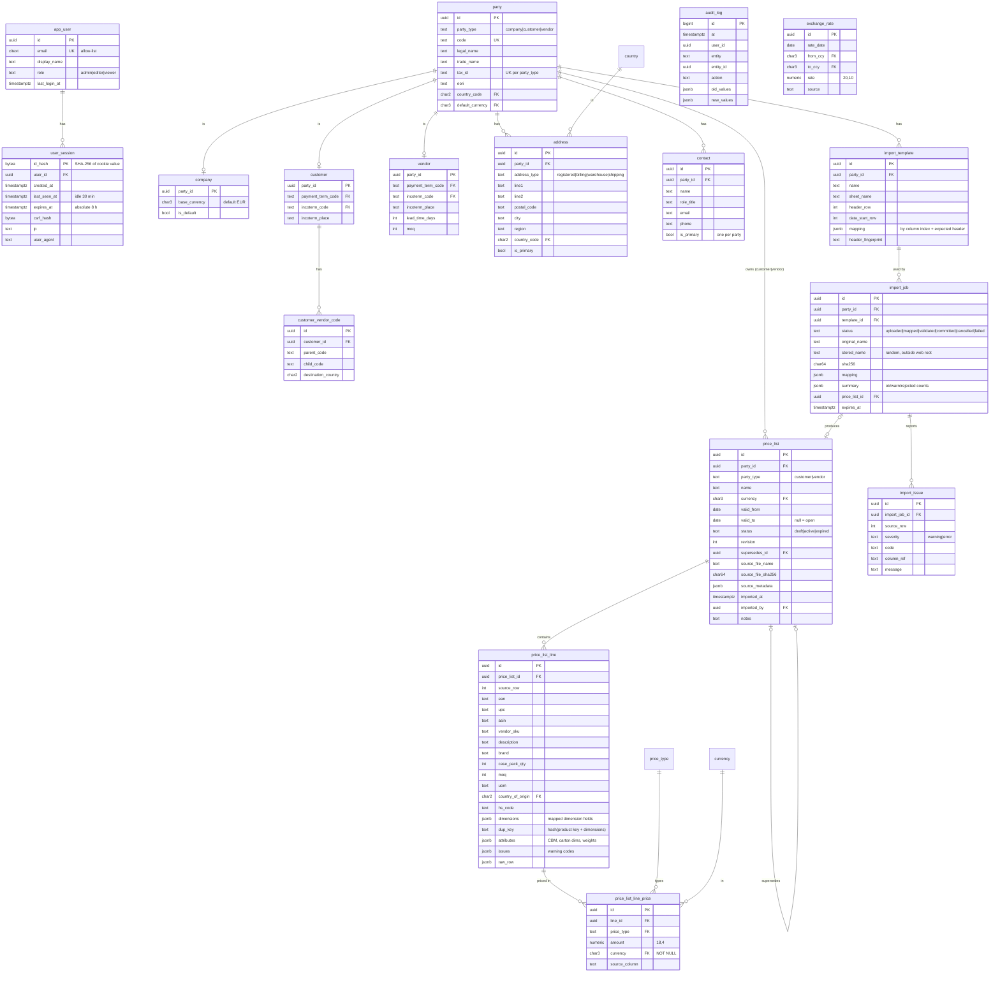

# BVT MDM v1 — Phase 1 plan

Status: **approved 2026-10-16** with the additions in §3. **Scope change 2026-10-16:** bank details and the Finance role are removed from v1 (roles: Admin / Editor / Viewer). Everything is served from one origin, http://localhost:8080.

## 1. What I found

| Item | Finding | Consequence |
| --- | --- | --- |
| Existing DB draft | None. The only running Postgres (`BVT-PLCI-postgres16-test`, :54329) holds one empty DB `bvt_test`, owned by superuser `bvt`. You confirmed: design fresh. | No compare/keep step. Nothing existing is touched. |
| `.env` / `DATABASE_URL` | Not present. | Phase 2 ships `.env.example`; you fill `.env`. |
| Port 8000 | Taken by `BVT-PLCI-app-dev`. | The API is internal to Compose; the browser only uses **http://localhost:8080** (nginx proxies `/api` and `/auth`). OAuth redirect `http://localhost:8080/auth/callback`. |
| Python | Local is 3.14; spec says 3.12. | `uv` pins 3.12 locally; Docker uses `python:3.12-slim`. |
| Node / Docker / make / uv | v24 / 29.7 / 4.4 / 0.11 | OK. `psql` is not installed locally, so DB scripts run through `docker exec`. |
| Git | The folder is not a git repo. | `git init` in Phase 2 (gitleaks and `.gitignore` need it). |
| `Client prices AmzMx.xlsx` | Matches the spec: `ALL` is 7,521 × 43, header on row 4, data from row 7. Price currency comes from the header for R/S (USD) and from column **W** for X (RRP). | Covered by the wizard. |
| `NOBBY_…xlsx` | Matches the spec: header on row 7. Has **no dimension metadata** (`max_row=None` in read-only mode). Columns J/K have data but no header. Metadata rows 1–5 carry VAT 0.16 and FX rates. | Read by streaming until N blank rows in a row, never relying on `max_row`. Unnamed columns show as "Column J". |

## 2. Changes I propose to the spec

1. **Party supertype for owners.** Instead of `owner_type + owner_id` or two FKs, use one `mdm.party` table (company / customer / vendor) that `company`, `customer` and `vendor` extend 1:1. Addresses, contacts and price lists then have **one real FK** (`party_id`). Price lists are restricted to customer/vendor with a composite FK `(party_id, party_type)` + CHECK. Reasons: real referential integrity (a polymorphic `owner_id` can't have an FK), one implementation of addresses/contacts for all three modules, and room for future party types (forwarders, carriers) without schema changes.
2. **Lookup tables use natural code PKs** (`country.code CHAR(2)`, `currency.code CHAR(3)`, `price_type.code`, `incoterm.code`), not UUIDs. Exception to rule §4: codes are the standard and avoid joins everywhere.
3. **`mdm_app` needs DELETE on a few tables:** `user_session` and `oauth_login_state` (logout and expiry cleanup), `import_file`/`import_issue` (temp data), and the business tables (Admin hard delete). Never on `audit_log` or on price list tables, so price history can't be deleted by the app.
4. **Hard delete is RESTRICT:** an Admin can hard-delete a party only if it has no price lists. Otherwise soft delete only.
5. **Amazon vendor codes go in a child table** (`customer_vendor_code`: parent, child, destination country), because one customer has several parent/child pairs.
6. **The line also gets a `upc` column** (Amazon has EAN and UPC). The product-key rule becomes: at least one of EAN / UPC / ASIN.
7. **Audit for imports is one entry per import** (file, hash, counts, resulting price list), not one per line (that would be about 45k rows per file). Line/price rows are immutable once imported.
8. **The Nobby metadata block** (VAT, FX rates, "valid from") is kept verbatim in `price_list.source_metadata` (JSONB) for traceability. It is **not** written to `exchange_rate` (rule §5). "valid from" is offered as a suggestion for `valid_from`, and the user confirms it.
9. **Added dependencies:** `psycopg[binary]` 3 (driver), `slowapi` (rate limit, in-process: fine for one instance, see limitations), `httpx` (needed by Authlib; Authlib itself pulls in `cryptography` for ID-token signature checks), `react-router`. No UI component library: plain CSS, to keep it simple.

## 3. Approved decisions (2026-10-16)

- **D1 Database.** MDM has its own Compose `db` service (`postgres:16`, host port **54330**, named volume `mdm_pg_data`).
- **D3 Company.** Several company rows are allowed, with exactly one `is_default` (partial unique index).
- **D4 Duplicates.** Duplicate keys inside one file are imported and flagged.
  - The duplicate key is the product key (EAN / UPC / ASIN) **plus every field mapped as a dimension** in the template (e.g. shipping port, destination country). Rows that differ in any dimension are not duplicates.
  - Lines store `dimensions` (JSONB) and `dup_key` (hash of key + dimensions).
  - The user resolves a duplicate group by excluding lines (`is_active = false`, only while the list is Draft).
  - **Activation is refused while any `dup_key` has more than one active line.**

## 4. Schema (`mdm`, Alembic-only)

Common columns on every non-lookup table, shown once as `AUDITED`: `id UUID PK`, `created_at timestamptz`, `created_by UUID → app_user`, `updated_at`, `updated_by`, `is_active bool`, `version int` (optimistic lock: `UPDATE … WHERE id=? AND version=?`; 0 rows → 409).



Lookups (seeded by a data migration): `country` (ISO 3166-1 α-2, 249 rows), `currency` (ISO 4217 active codes + minor units), `price_type` (purchase, domestic_cost, import_cost, rrp, rrp_ex_vat, retailer_cost; Admin can add more), `incoterm` (Incoterms 2020: EXW…DDP), `payment_term` (e.g. NET30, NET60, PREPAY; Admin-editable). Also `oauth_login_state` (state, nonce, PKCE verifier, 10-min TTL; server-side, so nothing sensitive goes in a cookie).

Key constraints:
- `party`: `UNIQUE(code)`; `UNIQUE(party_type, tax_id_normalized)` across all rows, including inactive ones (reactivate instead of re-creating).
- `price_list`: `EXCLUDE USING gist (party_id WITH =, currency WITH =, daterange(valid_from, valid_to, '[]') WITH &&) WHERE (status = 'active')` (needs `btree_gist`). Activation runs in one transaction: lock the owner's lists, expire the overlapping active one (`valid_to = new.valid_from − 1`, status expired), activate the new one. Lists whose `valid_to` has passed are shown and treated as Expired.
- `price_list_line`: `CHECK (ean IS NOT NULL OR upc IS NOT NULL OR asin IS NOT NULL)`, `CHECK (asin ~ '^[A-Z0-9]{10}$')`, and an index on `(ean)` and `(asin)` for future cross-list matching (margin analysis).
- `price_list_line_price`: `UNIQUE(line_id, price_type, currency)`, `amount NUMERIC(18,4) NOT NULL`, `currency NOT NULL`.
- `price_list.source_file_sha256`: re-importing an identical file for the same party gives a warning (it isn't blocked).
- `audit_log`: `mdm_app` has INSERT only (plus USAGE on its sequence); there's no UPDATE/DELETE grant.

Why this doesn't block later work: lines carry EAN/ASIN keys that a future `product` table can link to (`product_id` gets added as a nullable FK); prices keep their currency and validity dates, which margin and FX analysis need; `exchange_rate` exists with its key; and party types can be extended for forwarders and carriers (POs, shipments).

## 5. DB roles

A one-time bootstrap script `db/bootstrap.sql`, run as superuser via `make db-bootstrap`, creates the `mdm` DB and the roles `mdm_migrator` (owns schema `mdm`), `mdm_app` and `mdm_readonly`, all LOGIN, non-superuser, no CREATEROLE, with passwords taken from env. Alembic connects as `mdm_migrator` and sets `ALTER DEFAULT PRIVILEGES` so new tables get the right grants automatically, plus explicit per-table grants for `audit_log`. The API connects as `mdm_app`. `sslmode=require` is enforced when the host is not localhost/`db`.

## 6. Folder layout

```
MDM/
├─ CLAUDE.md  README.md  .env.example  .gitignore  docker-compose.yml  Makefile
├─ db/bootstrap.sql                  # roles + DB, superuser, run once
├─ api/
│  ├─ pyproject.toml  uv.lock  Dockerfile  alembic.ini
│  ├─ alembic/versions/
│  ├─ app/
│  │  ├─ main.py  config.py  db.py
│  │  ├─ core/        # errors, pagination, base model mixins, optimistic lock
│  │  ├─ security/    # headers, csrf, rate limit, crypto (AES-GCM), roles
│  │  ├─ auth/        # OIDC (Authlib), sessions, current-user deps
│  │  ├─ audit/
│  │  ├─ lookups/
│  │  ├─ parties/     # shared addresses, contacts
│  │  ├─ company/  customers/  vendors/
│  │  ├─ pricelists/
│  │  └─ imports/     # reader, header detect, gtin, mapping, validator, wizard API
│  └─ tests/          # pytest against real Postgres (DB mdm_test), role matrix, samples
└─ web/
   ├─ package.json  vite.config.ts  Dockerfile  nginx.conf
   └─ src/
      ├─ api/         # fetch client: credentials:'include', CSRF header, 409 handling
      ├─ components/  # DataTable (TanStack), Form fields, ConfirmDialog
      └─ features/    # company, customers, vendors, pricelists, imports, admin
```

Runtime topology: the browser only ever talks to **one origin, http://localhost:8080** (always `localhost`, never `127.0.0.1`, so cookies match). nginx in `web` serves the build and proxies `/api` and `/auth` to the API, which publishes no host port. So cookies stay first-party, `SameSite=Lax` works, and CORS stays a strict allow-list. Session cookie: `__Host-mdm_session` (the prefix forces Secure, Path=/ and no Domain, and avoids collisions with the PL&CI app's cookies on `localhost`).

Tests use a real Postgres (exclusion constraints, grants and role behaviour can't be faked with SQLite). Fixtures create and migrate `mdm_test`. Google is mocked with a local JWKS and signed test ID tokens.

## 7. Phase 2 deliverables (after approval)

`git init`; Compose (api, web, `db` with profile `localdb`); FastAPI app with `/api/health` (checks the DB); React shell; Alembic with migration 0001 (extensions, schema, lookups + seeds, `app_user`, `audit_log`); `db/bootstrap.sql`; `.env.example`; Makefile targets `dev`, `test`, `lint`, `typecheck`, `audit` (pip-audit, npm audit, bandit, gitleaks via Docker); `## Conventions` appended to CLAUDE.md.
